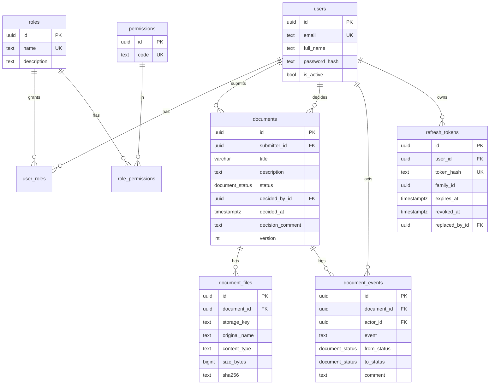
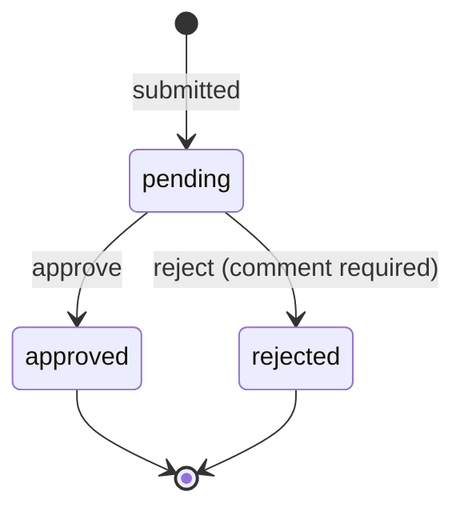

# DocFlow: document approval workflow

Submitters upload a document. Reviewers approve it, or reject it with a comment. Every submission and decision goes into an append-only audit trail.

There are two small React apps on one FastAPI API:

| App | Who | Local URL |
|---|---|---|
| `frontend-submitter` | Submitters upload documents and track their status | http://localhost:5173 |
| `frontend-reviewer` | Reviewers work through the queue | http://localhost:5174 |

Each app accepts only its own role. A reviewer logging into the submitter app gets the same "Invalid email or password" as a wrong password.


## Quick start

Prerequisites: Python 3.12 with [uv](https://docs.astral.sh/uv/), Node 20+, and PostgreSQL 16+.

```bash
cp .env.example .env            # set DATABASE_URL, TEST_DATABASE_URL, JWT_SECRET
createdb docflow_dev && createdb docflow_test
make setup && make dev          # runs migrations, then the API and both apps
```

- API: http://localhost:8000 (Swagger at http://localhost:8000/docs)
- Submitter app: http://localhost:5173
- Reviewer app: http://localhost:5174

Seed users, for local evaluation only. Migration `0002` creates them, and the passwords come from `SEED_SUBMITTER_PASSWORD` and `SEED_REVIEWER_PASSWORD`:

| User | Email | Password (default) | Role |
|---|---|---|---|
| Sam Carter | `sam.submitter@docflow.dev` | `submitter123` | submitter |
| Riya Menon | `riya.reviewer@docflow.dev` | `reviewer123` | reviewer |

`make seed` re-applies them idempotently, for example after changing the passwords.

Other commands: `make test`, `make e2e`, `make migrate`, `make build`, `make lint`.

## API design

Interactive docs: `/docs`. Every error has the same shape:

```json
{"error": {"code": "VALIDATION_ERROR", "message": "A comment is required when rejecting a document", "fields": {"comment": "Required when rejecting"}}}
```

Codes: `VALIDATION_ERROR` 400, `UNAUTHENTICATED` 401, `FORBIDDEN` 403, `NOT_FOUND` 404, `INVALID_TRANSITION` / `CONFLICT` 409, `FILE_TOO_LARGE` 413, `UNSUPPORTED_FILE_TYPE` 415.

| Method | Path | Permission | Purpose |
|---|---|---|---|
| POST | `/api/auth/login` | none | OAuth2 password form → access token, plus a refresh cookie |
| POST | `/api/auth/refresh` | refresh cookie | Rotate the refresh token, get a new access token |
| POST | `/api/auth/logout` | refresh cookie | Revoke the token, clear the cookie |
| GET | `/api/auth/me` | any user | `{id, email, full_name, roles, permissions}` |
| POST | `/api/documents` | `document:create` | Multipart `title`, `description?`, `file` → 201 |
| GET | `/api/documents` | `document:read_own` or `read_all` | `?status=&limit=&offset=&sort=-created_at` → `{items, total}` |
| GET | `/api/documents/{id}` | `read_own` (own only) or `read_all` | Document with file metadata and events |
| GET | `/api/documents/{id}/file` | `file:download_own` or `download_all` | Streams the file |
| POST | `/api/documents/{id}/decision` | `document:review` | `{decision, comment?, version}` |
| GET | `/api/health` | none | Checks the DB as well |

Submit a document:

```bash
curl -X POST localhost:8000/api/documents -H "Authorization: Bearer $TOKEN" \
  -F title="Q3 vendor contract" -F description="Renewal" -F file=@contract.pdf
```
```json
{"id": "6f1c…", "title": "Q3 vendor contract", "description": "Renewal", "status": "pending", "version": 1,
 "submitter": {"id": "…", "full_name": "Sam Carter", "email": "sam.submitter@docflow.dev"},
 "decided_by": null, "decided_at": null, "decision_comment": null,
 "file": {"id": "…", "original_name": "contract.pdf", "content_type": "application/pdf", "size_bytes": 48211, "sha256": "9b2e…"},
 "created_at": "2026-11-10T17:02:11Z", "updated_at": "2026-11-10T17:02:11Z"}
```

Reject it:

```bash
curl -X POST localhost:8000/api/documents/6f1c…/decision -H "Authorization: Bearer $TOKEN" \
  -H "Content-Type: application/json" -d '{"decision": "reject", "comment": "Missing signature page", "version": 1}'
```
```json
{"id": "6f1c…", "status": "rejected", "version": 2, "decided_by": {"full_name": "Riya Menon", "…": "…"},
 "decided_at": "2026-11-10T17:05:40Z", "decision_comment": "Missing signature page", "…": "…"}
```

**Why a decision is its own action, not a PATCH on `status`.** A decision is a business event with rules: only from `pending`, a comment is required on reject, you can't review your own document, and it has to be safe under concurrency. It also writes an audit row. A `POST /decision` endpoint gives all of that one entry point (`services.decide()`), and the status column can't be edited directly. Adding "changes requested" or a second approval step later means a new decision value, not a new way to change status.

**Why someone else's document returns 404, not 403.** A 403 confirms the document exists. With UUIDs that's a small leak, but there's no reason to have it. Malformed ids also return 404.

**Why checks use permissions, not role names.** Routes ask for `document:review`, not "is reviewer". Roles are rows in the database that map to permissions, so a new role (an auditor with `document:read_all` only, say) needs no code change. Permissions are loaded from the DB on every request, so revoking a role or deactivating a user takes effect at once rather than when the token expires.

## Data model





The database enforces the rules too, so a bug or a manual SQL session can't create an invalid state:

- `status` is a Postgres enum (`document_status`).
- A pending document has no `decided_by_id` or `decided_at`. A decided one has both.
- A rejected document must have a `decision_comment`.
- `title` is 1–200 characters. `description` and `decision_comment` are at most 5000.
- `version >= 1`, `size_bytes > 0`, and emails are stored lowercase.
- Every foreign key is indexed, and `(status, created_at desc)` backs the reviewer queue.

Concurrency: `decide()` takes `SELECT … FOR UPDATE` on the row and checks the client's `version`. Two reviewers acting at once get one 200 and one 409.

Uploads are streamed to disk in 1 MB chunks and hashed as they're written. Upload aborts with a 413 as soon as the file passes the limit (10 MB by default, `MAX_UPLOAD_MB`). The file goes to a temporary key, the rows are committed, and then the file moves to its final key. A failure at any step leaves nothing behind.

## Major decisions and trade-offs

- **Postgres with real migrations, not in-memory storage.** The rules live in constraints as well as code, and Alembic migrations (`0001` schema, `0002` seed, `0003` length limits) all have working downgrades. The tests run against real Postgres for the same reason.
- **Local file storage behind a `Storage` interface** (`save / open / move / delete`). S3 becomes a new class, with no change to the routes.
- **One file per document for now.** `document_files` is already one-to-many, so multiple attachments are a UI change.
- **No resubmission yet.** A rejected document is final. `document_events` already records every transition, so a "changes requested" state slots into `decide()` and the enum.
- **No background workers.** There's nothing to run asynchronously yet: validation, hashing and storage all fit inside the request. See next steps.
- **Two frontend apps.** The submitter and reviewer get separate deployable apps on separate domains. They share no code at runtime, so each one stays small and obvious.
- **Auth.** Access tokens are JWTs that live for 15 minutes and are kept in memory only. Refresh tokens are random, stored only as a sha256 hash, sent as an httpOnly SameSite=Lax cookie (`Secure` when `COOKIE_SECURE=true`) and rotated on every use. Reusing a rotated token revokes the whole token family.

## Tests

```bash
make test   # backend: pytest against real Postgres (TEST_DATABASE_URL), with coverage
make e2e    # Playwright: Sam submits → Riya rejects with a comment → Sam sees "Rejected" and the comment
```

The schema comes from running the Alembic migrations, not `create_all`. Each test runs inside a transaction that's rolled back afterwards, and the whole suite runs in a few seconds.

| File | Covers |
|---|---|
| `test_migrations.py` | upgrade → downgrade base → upgrade, and the seed data |
| `test_auth.py` | login, wrong password, unknown email, inactive user, expired and tampered tokens, refresh rotation, reuse detection, logout, `/me` |
| `test_rbac.py` | a matrix of every endpoint × {anonymous, submitter, reviewer, other submitter} |
| `test_documents_create.py` | happy path with sha256, missing or long title, missing, empty, too large or wrong-type file, the event row |
| `test_documents_read.py` | ownership, status filter, pagination and total, sort, 404 on others' documents, download rules |
| `test_decisions.py` | approve, reject with and without a comment, already decided, stale version, own document, submitter attempt, unknown id, the event trail |
| `test_concurrency.py` | two reviewers at once via `asyncio.gather`: exactly one 200 and one 409 |
| `test_services.py` | the state machine on its own |
| `test_constraints.py` | the DB check constraints reject bad rows with the service bypassed |

Coverage on `services.py`, `security.py` and the routers is 100%.

## AI tools used

TODO

## Production next steps

- **Worker queue (Celery or arq on Redis), once there's work for it:** virus scanning, text extraction and previews, email or webhook notifications on decisions, and retention or cleanup jobs. The `Storage` interface and `document_events` are the hooks these would use.
- S3 storage with presigned upload and download URLs, plus virus scanning before a file becomes downloadable.
- SSO / OIDC instead of local passwords.
- Email or webhook notifications on decisions.
- A resubmit / "changes requested" state.
- Multi-step approvals.
- Rate limiting, especially on login.
- Structured logging and request tracing.
- CI that runs the test suite and the e2e test on every push.
- A background job for retention.

## Video

TODO: Loom link
