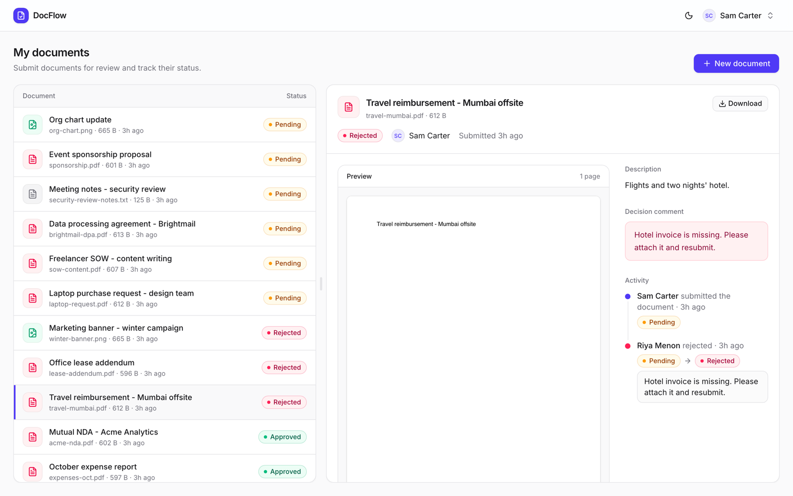
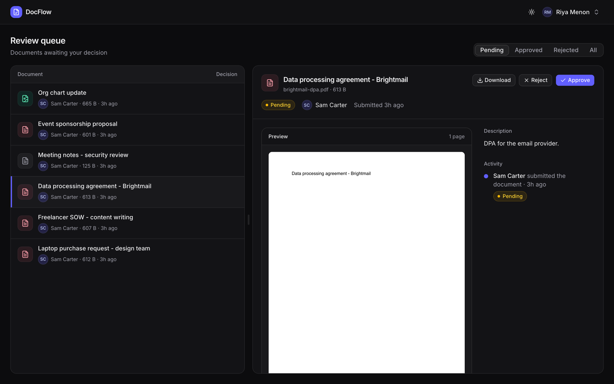
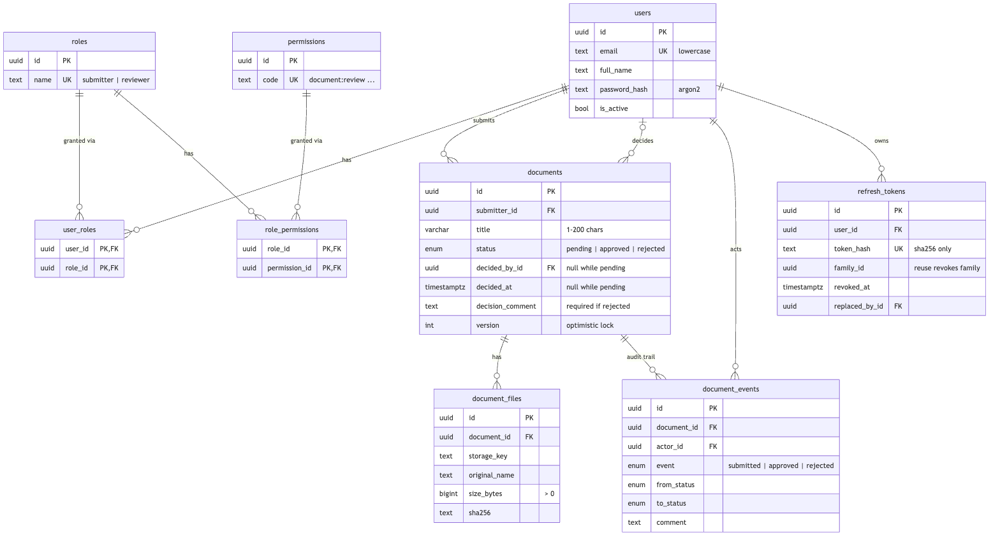
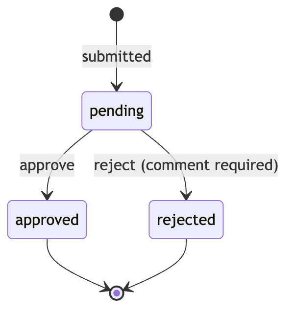

# DocFlow: document approval workflow

Submitters upload a document. Reviewers approve it, or reject it with a comment. Every submission and decision goes into an append-only audit trail.

There are two small React apps on one FastAPI API:

| App | Who | Local URL |
|---|---|---|
| `frontend-submitter` | Submitters upload documents and track their status | http://localhost:5173 |
| `frontend-reviewer` | Reviewers work through the queue | http://localhost:5174 |

Each app accepts only its own role. A reviewer logging into the submitter app gets the same "Invalid email or password" as a wrong password.

Live: [springboard.bixops.in](https://springboard.bixops.in) (submitter) · [springboard-admin.bixops.in](https://springboard-admin.bixops.in) (reviewer) · [API docs](https://springboard.bixops.in/docs). The [design doc](docs/design-doc.md) covers the backend in diagrams.

**Submitter:** a rejected document, with the preview, the reviewer's comment and the audit trail.



**Reviewer (dark mode):** the pending queue, with the document open next to Approve and Reject.



## Quick start

Prerequisites: Python 3.12 with [uv](https://docs.astral.sh/uv/), Node 20+, and PostgreSQL 16+.

```bash
cp .env.example .env            # set DATABASE_URL, TEST_DATABASE_URL, JWT_SECRET
createdb docflow_dev && createdb docflow_test
make setup && make dev          # runs migrations, then the API and both apps
```

- API: http://localhost:8000 (Swagger at http://localhost:8000/docs)
- Submitter app: http://localhost:5173
- Reviewer app: http://localhost:5174

Seed users, for local evaluation only. Migration `0002` creates them, and the passwords come from `SEED_SUBMITTER_PASSWORD` and `SEED_REVIEWER_PASSWORD`:

| User | Email | Password (default) | Role |
|---|---|---|---|
| Sam Carter | `sam.submitter@docflow.dev` | `submitter123` | submitter |
| Riya Menon | `riya.reviewer@docflow.dev` | `reviewer123` | reviewer |

`make seed` re-applies them idempotently, for example after changing the passwords.

Other commands: `make test`, `make e2e`, `make migrate`, `make build`, `make lint`.

## API design

Interactive docs: `/docs`. Every error has the same shape:

```json
{"error": {"code": "VALIDATION_ERROR", "message": "A comment is required when rejecting a document", "fields": {"comment": "Required when rejecting"}}}
```

Codes: `VALIDATION_ERROR` 400, `UNAUTHENTICATED` 401, `FORBIDDEN` 403, `NOT_FOUND` 404, `INVALID_TRANSITION` / `CONFLICT` 409, `FILE_TOO_LARGE` 413, `UNSUPPORTED_FILE_TYPE` 415, `RATE_LIMITED` 429 (with `Retry-After`).

| Method | Path | Permission | Purpose |
|---|---|---|---|
| POST | `/api/auth/login` | none | OAuth2 password form → access token, plus a refresh cookie |
| POST | `/api/auth/refresh` | refresh cookie | Rotate the refresh token, get a new access token |
| POST | `/api/auth/logout` | refresh cookie | Revoke the token, clear the cookie |
| GET | `/api/auth/me` | any user | `{id, email, full_name, roles, permissions}` |
| POST | `/api/documents` | `document:create` | Multipart `title`, `description?`, `file` → 201 |
| GET | `/api/documents` | `document:read_own` or `read_all` | `?status=&limit=&offset=&sort=-created_at` → `{items, total}` |
| GET | `/api/documents/{id}` | `read_own` (own only) or `read_all` | Document with file metadata and events |
| GET | `/api/documents/{id}/file` | `file:download_own` or `download_all` | Streams the file |
| POST | `/api/documents/{id}/decision` | `document:review` | `{decision, comment?, version}` |
| GET | `/api/health` | none | Checks the DB as well |

Submit a document:

```bash
curl -X POST localhost:8000/api/documents -H "Authorization: Bearer $TOKEN" \
  -F title="Q3 vendor contract" -F description="Renewal" -F file=@contract.pdf
```
```json
{"id": "6f1c…", "title": "Q3 vendor contract", "description": "Renewal", "status": "pending", "version": 1,
 "submitter": {"id": "…", "full_name": "Sam Carter", "email": "sam.submitter@docflow.dev"},
 "decided_by": null, "decided_at": null, "decision_comment": null,
 "file": {"id": "…", "original_name": "contract.pdf", "content_type": "application/pdf", "size_bytes": 48211, "sha256": "9b2e…"},
 "created_at": "2026-11-10T17:02:11Z", "updated_at": "2026-11-10T17:02:11Z"}
```

Reject it:

```bash
curl -X POST localhost:8000/api/documents/6f1c…/decision -H "Authorization: Bearer $TOKEN" \
  -H "Content-Type: application/json" -d '{"decision": "reject", "comment": "Missing signature page", "version": 1}'
```
```json
{"id": "6f1c…", "status": "rejected", "version": 2, "decided_by": {"full_name": "Riya Menon", "…": "…"},
 "decided_at": "2026-11-10T17:05:40Z", "decision_comment": "Missing signature page", "…": "…"}
```

**Why a decision is its own action, not a PATCH on `status`.** A decision is a business event with rules: only from `pending`, a comment is required on reject, you can't review your own document, and it has to be safe under concurrency. It also writes an audit row. A `POST /decision` endpoint gives all of that one entry point (`services.decide()`), and the status column can't be edited directly. Adding "changes requested" or a second approval step later means a new decision value, not a new way to change status.

**Why someone else's document returns 404, not 403.** A 403 confirms the document exists. With UUIDs that's a small leak, but there's no reason to have it. Malformed ids also return 404.

**Why checks use permissions, not role names.** Routes ask for `document:review`, not "is reviewer". Roles are rows in the database that map to permissions, so a new role (an auditor with `document:read_all` only, say) needs no code change. Permissions are loaded from the DB on every request, so revoking a role or deactivating a user takes effect at once rather than when the token expires.

## Data model





The database enforces the rules too, so a bug or a manual SQL session can't create an invalid state:

- `status` is a Postgres enum (`document_status`).
- A pending document has no `decided_by_id` or `decided_at`. A decided one has both.
- A rejected document must have a `decision_comment`.
- `title` is 1–200 characters. `description` and `decision_comment` are at most 5000.
- `version >= 1`, `size_bytes > 0`, and emails are stored lowercase.
- Every foreign key is indexed, and `(status, created_at desc)` backs the reviewer queue.

Concurrency: `decide()` takes `SELECT … FOR UPDATE` on the row and checks the client's `version`. Two reviewers acting at once get one 200 and one 409.

Uploads are streamed to disk in 1 MB chunks and hashed as they're written. Upload aborts with a 413 as soon as the file passes the limit (10 MB by default, `MAX_UPLOAD_MB`). Before that, a small ASGI middleware refuses an upload whose `Content-Length` is over the limit plus 1 MB of multipart overhead without reading the body, and cuts off a chunked body once it passes the same cap. The file goes to a temporary key, the rows are committed, and then the file moves to its final key. A failure at any step leaves nothing behind.

## Major decisions and trade-offs

- **Postgres with real migrations, not in-memory storage.** The rules live in constraints as well as code, and Alembic migrations (`0001` schema, `0002` seed, `0003` length limits) all have working downgrades. The tests run against real Postgres for the same reason.
- **Local file storage behind a `Storage` interface** (`save / open / move / delete`). S3 becomes a new class, with no change to the routes.
- **One file per document for now.** `document_files` is already one-to-many, so multiple attachments are a UI change.
- **No resubmission yet.** A rejected document is final. `document_events` already records every transition, so a "changes requested" state slots into `decide()` and the enum.
- **No background workers.** There's nothing to run asynchronously yet: validation, hashing and storage all fit inside the request. See next steps.
- **Two frontend apps.** The submitter and reviewer get separate deployable apps on separate domains. They share no code at runtime, so each one stays small and obvious.
- **Auth.** Access tokens are JWTs that live for 15 minutes and are kept in memory only. Refresh tokens are random, stored only as a sha256 hash, sent as an httpOnly SameSite=Lax cookie (`Secure` when `COOKIE_SECURE=true`) and rotated on every use. Reusing a rotated token revokes the whole token family. Login is rate limited in memory (sliding window, single worker): 5 attempts a minute per client IP and email, and 20 per client IP.
- **Logging.** One JSON line per request on stdout (method, path, status, duration_ms, request_id, user_id), at `LOG_LEVEL` (default INFO). Each response carries an `X-Request-ID` (a sane incoming one is kept). A 500 is logged with its traceback, and its message includes the request id so users can quote it. Headers, bodies, passwords and tokens are never logged. Uvicorn's own access log duplicates the request line, so production can run it with `--no-access-log`.
- **Error reporting.** Sentry is switched on only when `SENTRY_DSN` is set (`SENTRY_ENVIRONMENT`, `SENTRY_TRACES_SAMPLE_RATE` default to `development` and `0.0`). Unhandled exceptions are reported once, tagged with the request id, without default PII. Expected 4xx errors aren't reported. The two frontends report browser errors when built with `VITE_SENTRY_DSN` (and `VITE_SENTRY_ENVIRONMENT`). Vite bakes these in at build time from each app's own gitignored `.env.production`, so `make build` picks them up while `make dev` and `make e2e` stay quiet.

## Tests

```bash
make test   # backend: pytest against real Postgres (TEST_DATABASE_URL), with coverage
make e2e    # Playwright: Sam submits → Riya rejects with a comment → Sam sees "Rejected" and the comment
```

The schema comes from running the Alembic migrations, not `create_all`. Each test runs inside a transaction that's rolled back afterwards, and the whole suite runs in a few seconds.

| File | Covers |
|---|---|
| `test_migrations.py` | upgrade → downgrade base → upgrade, and the seed data |
| `test_auth.py` | login, wrong password, unknown email, inactive user, expired and tampered tokens, refresh rotation, reuse detection, logout, `/me`, login rate limits |
| `test_rbac.py` | a matrix of every endpoint × {anonymous, submitter, reviewer, other submitter} |
| `test_documents_create.py` | happy path with sha256, missing or long title, missing, empty, too large or wrong-type file, the event row |
| `test_documents_read.py` | ownership, status filter, pagination and total, sort, 404 on others' documents, download rules |
| `test_decisions.py` | approve, reject with and without a comment, already decided, stale version, own document, submitter attempt, unknown id, the event trail |
| `test_concurrency.py` | two reviewers at once via `asyncio.gather`: exactly one 200 and one 409 |
| `test_services.py` | the state machine on its own |
| `test_constraints.py` | the DB check constraints reject bad rows with the service bypassed |

Coverage on `services.py`, `security.py` and the routers is 100%.

## AI tools used

I built this with **Claude Code** (Anthropic) as the main tool. It wrote most of the code; I made the decisions, tested, and reviewed. Specifically:

- **Starting point:** a detailed build spec covering the stack, schema, API, test list and constraints. Claude worked from that, and asked me before any decision the spec didn't cover.
- **Parallel builds:** Claude ran separate subagents for the backend and the frontend at the same time, each committing its own milestones. Later agents handled the UI redesign, the Sentry setup and a design review using Anthropic's `frontend-design` skill.
- **My decisions, made along the way:** FastAPI over Django, two separate frontend apps, sharing the droplet's existing Postgres, the login rate-limit policy, Sentry over self-hosting, the login and split-view layouts, and what to fix from the shortcomings list.
- **Generated by AI:** scaffolding, the models and migrations, the 167-test suite and the RBAC matrix, the UI, the Playwright test, the deploy scripts, and the first drafts of the docs.
- **Verification:** nothing was taken on trust. Tests and e2e ran before each commit, and Sentry was verified in production. That check turned up a double-count, which turned out to be a test artifact, not an app bug. I QA'd every UI change myself in the running apps, locally and on the live site, as both a submitter and a reviewer. That's where I found bugs the automated checks missed: state lost on window resize, Cancel jumping to the wrong document, and wasted space in the upload pane. Claude fixed those and added regression checks for them.
- **Other tools:** Sentry's MCP plugin (projects, alerts, verifying events), Playwright for visual checks, and mermaid-cli for the diagrams.

## Production next steps

- **Worker queue (Celery or arq on Redis), once there's work for it:** virus scanning, text extraction and previews, email or webhook notifications on decisions, and retention or cleanup jobs. The `Storage` interface and `document_events` are the hooks these would use.
- S3 storage with presigned upload and download URLs, plus virus scanning before a file becomes downloadable.
- SSO / OIDC instead of local passwords.
- Email or webhook notifications on decisions.
- A resubmit / "changes requested" state.
- Multi-step approvals.
- Rate limiting beyond login, backed by Redis once there's more than one worker.
- Log shipping and distributed tracing.
- CI that runs the test suite and the e2e test on every push.
- A background job for retention.

## Video

Walkthrough video (about 5 minutes): demo, design and tests, in [this Google Drive folder](https://drive.google.com/drive/folders/1bQqVGSghWG_l2rPi7AB4CE_2OZdk57eR).
