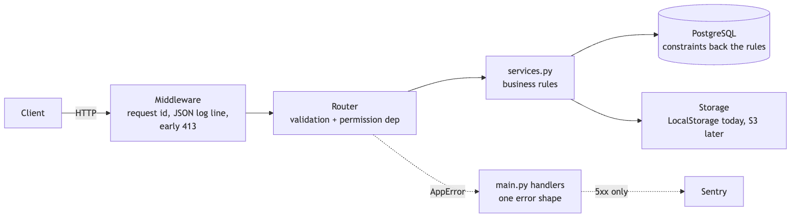
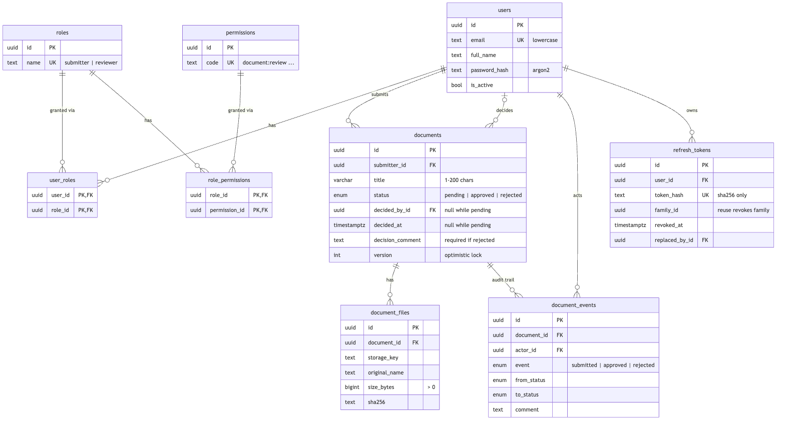
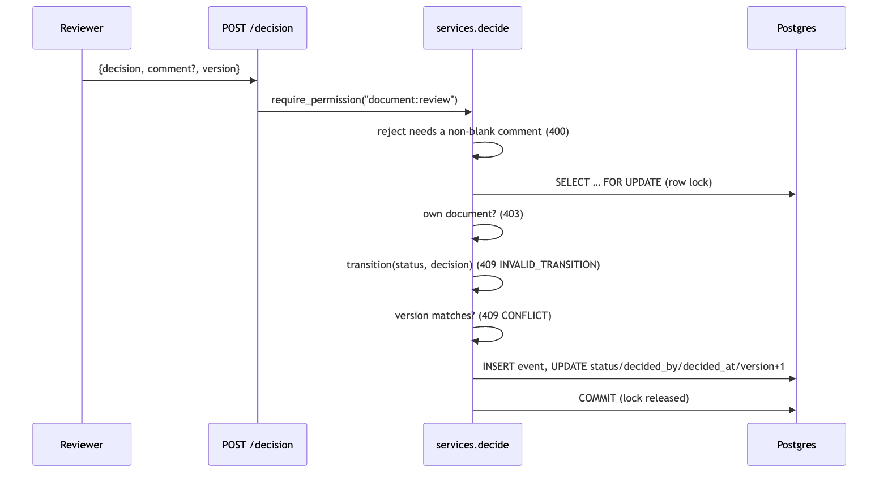
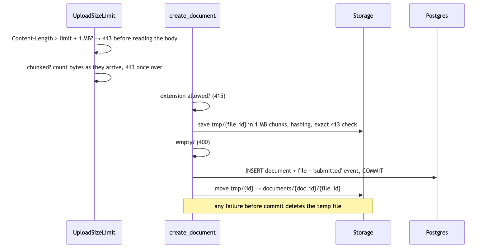

# DocFlow backend: design doc

## 1. DocFlow

**Submit a document → a reviewer approves or rejects it**
- FastAPI · PostgreSQL · SQLAlchemy async · Alembic
- 167 tests against real Postgres
- Live at springboard.bixops.in and springboard-admin.bixops.in

---

## 2. Architecture

---

## 3. Data model

---

## 4. The decision

---

## 5. Auth and permissions

- Short-lived access token, rotating refresh cookie
- Reused refresh token → whole session family revoked
- Checks by permission, not role name
- Someone else's document → 404, not 403

---

## 6. Uploads

---

## 7. Running it for real

- Login rate limit: 5/min per account, 20/min per IP
- JSON logs with request ids
- Sentry on backend and frontends, production alerts

---

## 8. Tests

- 167 tests, about 4 seconds, real Postgres
- Schema built by the actual migrations
- Permission matrix: every endpoint × every kind of user

---

## 9. What's next

- Still open: no backups · no CI · single worker · file type checked by extension
- Next: CI, backups, S3 with a worker queue, "changes requested" state

